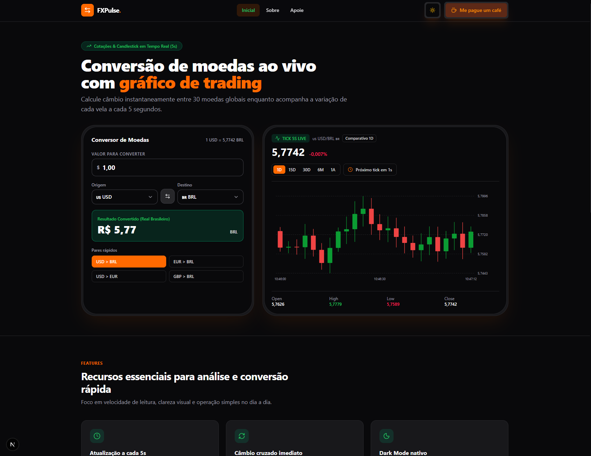
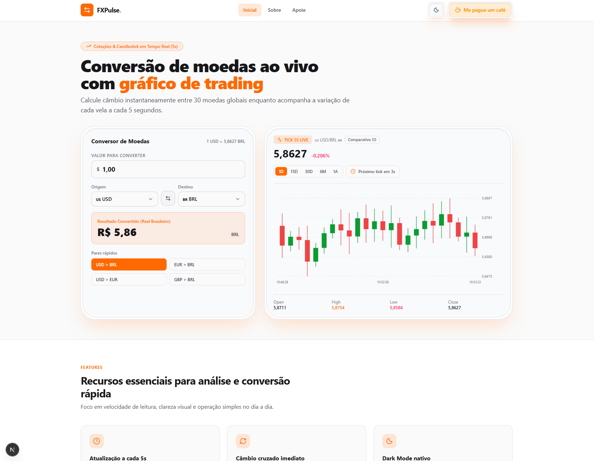

# FXPulse

| Dark Mode | Light Mode |
| :---: | :---: |
|  |  |

[](https://nextjs.org/)
[](https://react.dev/)
[](https://www.typescriptlang.org/)
[](https://tailwindcss.com/)
[](https://nextjs.org/docs/app/api-reference/turbopack)

Aplicação web de conversão de moedas e visualização de velas (OHLC) com atualização em tempo real a cada 5 segundos, suporte a modo claro e escuro sem flash inicial, dropdown pesquisável com 30 moedas globais e comparativo por períodos (`1D`, `15D`, `30D`, `6M`, `1A`).

---

## Sumário

- [Funcionalidades](#funcionalidades)
- [Páginas e Rotas](#páginas-e-rotas)
- [Estrutura do Projeto](#estrutura-do-projeto)
- [Instalação e Execução](#instalação-e-execução)
- [Observações](#observações)

---

## Funcionalidades

- **Conversor de Moedas em Tempo Real:** cálculo imediato entre 30 moedas (`USD`, `BRL`, `EUR`, `GBP`, `JPY`, `CAD`, `AUD`, `CHF`, `CNY`, `HKD`, `NZD`, `SEK`, `NOK`, `MXN`, `ARS`, `CLP`, `COP`, `PEN`, `UYU`, `INR`, `KRW`, `SGD`, `AED`, `SAR`, `ZAR`, `TRY`, `PLN`, `CZK`, `HUF` e `ILS`), inversão rápida e atalhos de pares.
- **Gráfico de Trading a Cada 5 Segundos:** velas OHLC em SVG com escala dinâmica, contagem regressiva até o próximo tick e métricas de `Open`, `High`, `Low` e `Close`.
- **Filtro Comparativo de Período:** alternância entre `1D`, `15D`, `30D`, `6M` e `1A` com ajuste de variação percentual e amplitude da série.
- **Dropdown Customizado com Busca:** filtragem por código ou nome da moeda, suporte a fechamento por clique externo ou tecla `Escape`.
- **Formatação Numérica (`pt-BR`):** separação de milhar por ponto e decimais por vírgula no campo de entrada e nos resultados convertidos.
- **Dark Mode e Light Mode sem Flash:** inicialização síncrona do tema no `<head>`, persistência em `localStorage` e barra de rolagem personalizada em `src/app/globals.css`.

---

## Páginas e Rotas

- **`/` (Inicial):** Hero com conversor e gráfico de 5s, seção de `Features`, `Grid Bento` com referência frente ao USD e `Footer`.
- **`/sobre` (Sobre):** propósito do projeto, como ajuda na prática e diferenciais frente a outras plataformas.
- **`/apoie` (Apoie):** seção "Me pague um café" com faixas de valor, valor personalizado e cópia de chave.

---

## Estrutura do Projeto

```text
src/
├── app/
│   ├── apoie/
│   │   └── page.tsx
│   ├── sobre/
│   │   └── page.tsx
│   ├── globals.css
│   ├── layout.tsx
│   └── page.tsx
├── components/
│   ├── BentoGridSection.tsx
│   ├── Dropdown.tsx
│   ├── FeaturesSection.tsx
│   ├── Footer.tsx
│   ├── Header.tsx
│   ├── HeroSection.tsx
│   ├── ThemeProvider.tsx
│   └── TradingChart.tsx
├── lib/
│   └── rates.ts
└── types/
    └── currency.ts

```

---

## Instalação e Execução

```bash
npm install
npm run dev

```

Acesse `http://localhost:3000` no navegador. Para gerar o build de produção:

```bash
npm run build
npm start

```

---

## Observações

* As cotações e velas geradas na aplicação são simuladas localmente para demonstração e testes visuais em tempo real.

---

Desenvolvido por

[](https://github.com/LeonardoFirme)